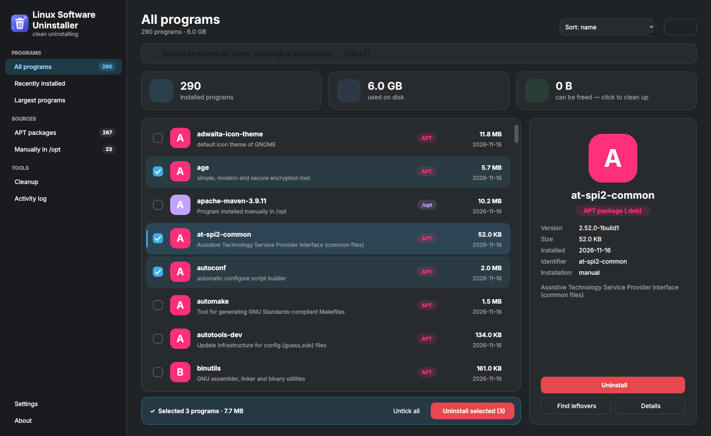
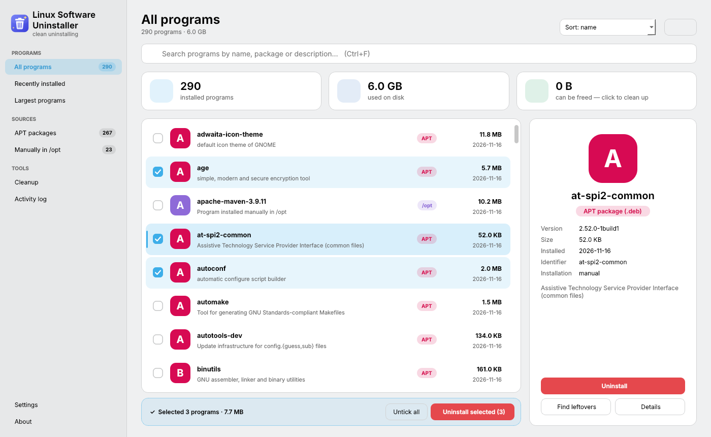
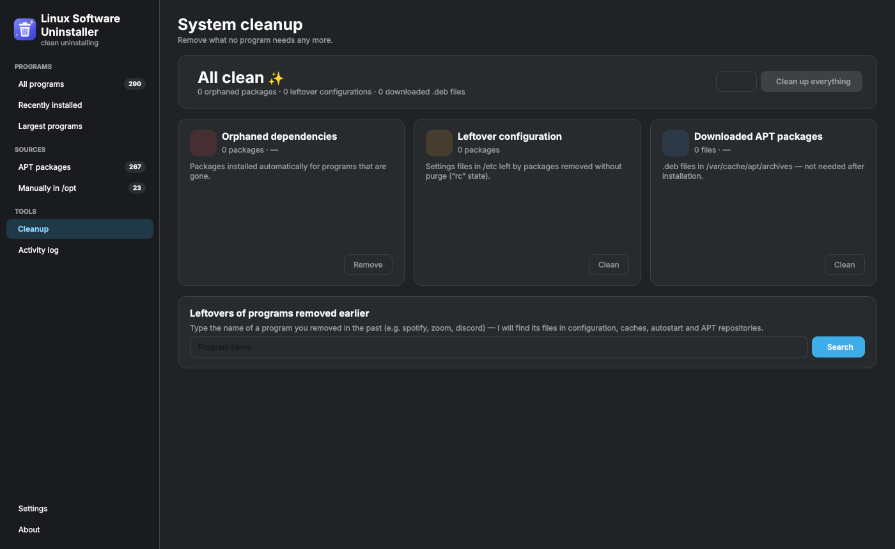
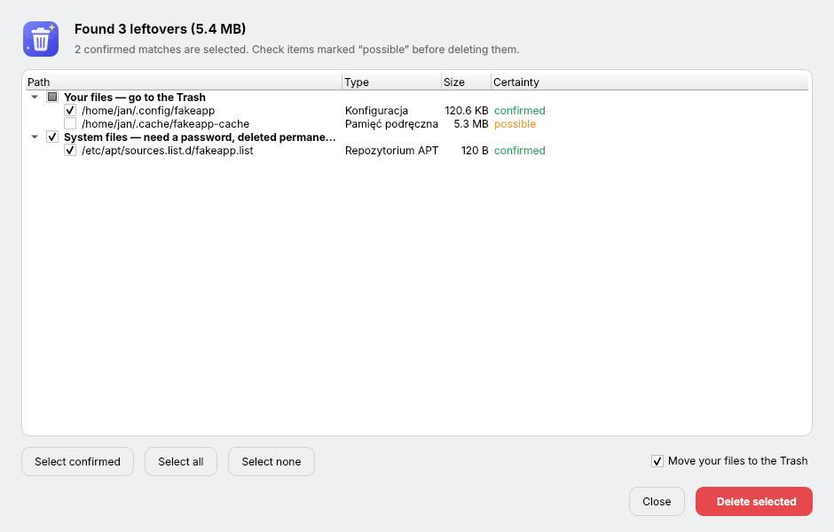
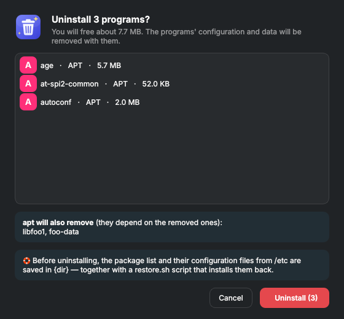
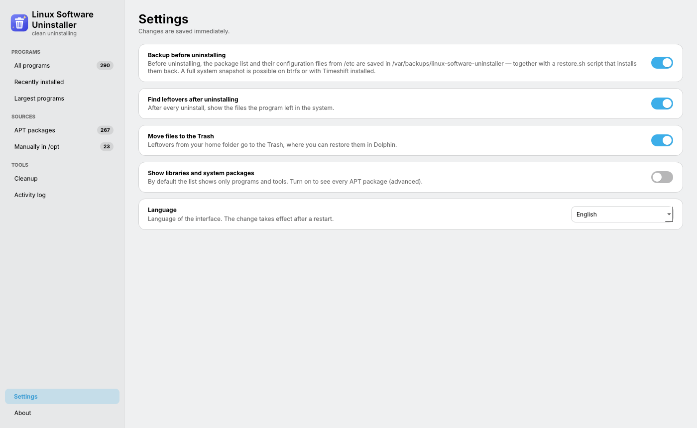
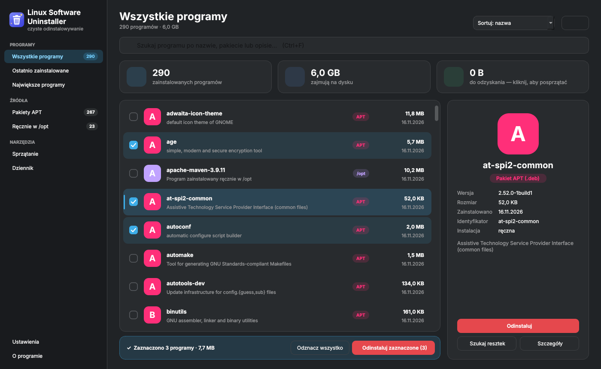

<div align="center">


# Linux Software Uninstaller

**Remove programs from Linux completely — together with their configuration and leftovers.**

An IObit Uninstaller–style tool for Debian and KDE Plasma that handles APT, Flatpak, Snap, AppImage and `/opt` in one window.

[](LICENSE)


🇵🇱 [Przeczytaj po polsku](README.pl.md)

</div>



> **Languages:** English (default) and Polish 🇵🇱 — switch in *Settings → Language*. More translations are welcome — see [Translating](#translating).

## Features

- **Every program in one place** — APT packages (`.deb`), Flatpak, Snap, AppImage files and programs unpacked by hand into `/opt`, with icons, size and installation date.
- **Smart views** — all programs, recently installed, largest, or one source at a time. Libraries and base-system packages are hidden by default.
- **Clean uninstall** — configuration and data go too (`apt purge`, `flatpak --delete-data`, `snap --purge`).
- **Safety checks** — shows what else APT will remove, warns before touching critical packages (KDE, sddm, the running kernel, apt…) and refuses to remove *Essential* packages.
- **Backup before uninstalling**, chosen automatically:
  | Your system | What happens |
  |---|---|
  | btrfs + snapper | snapper snapshot |
  | btrfs | read-only snapshot in `/.snapshots` |
  | ext4 etc. + Timeshift | Timeshift restore point |
  | anything else | package list + their `/etc` config files + a `restore.sh` script in `/var/backups/linux-software-uninstaller` |
- **Leftover scanner** — after uninstalling, finds files the program left behind in `~/.config`, `~/.local`, `~/.cache`, `~/.var/app`, autostart, menu entries, systemd units, `/etc`, `/var/lib`, APT repositories and signing keys. Your own files go to the **Trash**, so they can be restored.
- **System cleanup** — orphaned dependencies, leftover configuration of removed packages (`rc` state) and the APT download cache, all with one click.
- **Activity log** of everything that was removed.
- **Looks native** — follows your KDE colour scheme, light or dark.
- **Multilingual** — English and Polish, or automatically the language of your system.

<table>
  <tr>
    <td></td>
    <td></td>
  </tr>
  <tr>
    <td></td>
    <td></td>
  </tr>
  <tr>
    <td></td>
    <td></td>
  </tr>
</table>

## Installation

### From a release (recommended)

Download the latest `linux-software-uninstaller_*_all.deb` from [Releases](../../releases) and run:

```bash
sudo apt install ./linux-software-uninstaller_*_all.deb
```

Then open **System → Linux Software Uninstaller** from the application menu, or run `linux-software-uninstaller`.

### Build the package yourself

```bash
git clone https://github.com/USERNAME/linux-software-uninstaller.git
cd linux-software-uninstaller
./packaging/build-deb.sh
sudo apt install ./linux-software-uninstaller_*_all.deb
```

### Run without installing

```bash
sudo apt install python3-pyqt6
python3 -m linux_software_uninstaller
```

### Requirements

- Debian 13 “trixie” or newer (other Debian-based distributions should work too)
- Python 3.11+, PyQt6 (`python3-pyqt6`)
- polkit with a running authentication agent (in KDE: `polkit-kde-agent-1`) and `pkexec`
- optional: `qt6-svg-plugins` (icons), `btrfs-progs` / `snapper` / `timeshift` (backups), `flatpak`, `snapd`

## Usage

1. Find the program — type in the search box (<kbd>Ctrl</kbd>+<kbd>F</kbd>) or pick a view on the left.
2. Tick one or more programs (click the checkbox, double-click the row or press <kbd>Space</kbd>).
3. Click **Uninstall selected** and review the summary. Enter your password once.
4. Review the leftovers found — confirmed matches are pre-selected, “possible” ones are up to you.

| Shortcut | Action |
|---|---|
| <kbd>Ctrl</kbd>+<kbd>F</kbd> | search |
| <kbd>Space</kbd> | tick / untick the current program |
| <kbd>Delete</kbd> | uninstall ticked programs |
| <kbd>F5</kbd> | reload the list |
| <kbd>Esc</kbd> | clear the search |

## How it works and security

The window always runs as your normal user — **do not start it with `sudo`**.

Anything that needs root is done by a small helper, `/usr/libexec/linux-software-uninstaller/lsu-helper`, started through **polkit** (action `linux-software-uninstaller.helper`, password remembered for a few minutes). The helper accepts only three commands — `uninstall`, `remove-paths` and `cleanup` — and validates every argument:

- package, snap and Flatpak names must match strict patterns,
- paths must lie directly inside an allowed directory (for example `/etc`, `/var/lib`, `/opt`), never in `/home` or `/root`,
- files owned by any installed package are refused,
- core directories (`/etc/apt`, `/var/lib/dpkg`, `/etc/systemd`…) are always protected.

Leftover detection only flags names that match the removed program, skips anything that belongs to a program which is still installed, and marks uncertain matches as “possible” so they are never deleted without your decision.

## Files

| Path | Contents |
|---|---|
| `/usr/bin/linux-software-uninstaller` | launcher |
| `/usr/share/linux-software-uninstaller/` | Python modules |
| `/usr/libexec/linux-software-uninstaller/lsu-helper` | root helper |
| `~/.config/linux-software-uninstaller/` | settings |
| `~/.local/state/linux-software-uninstaller/activity.log` | activity log |
| `/var/backups/linux-software-uninstaller/` | configuration backups (root only) |

## Project layout

```
linux_software_uninstaller/
  app.py        main window and pages
  widgets.py    custom widgets (list delegate, cards, switches, toasts…)
  dialogs.py    progress, confirmation, leftovers and about dialogs
  theme.py      colours and stylesheet derived from the KDE palette
  i18n.py       translations (English source + Polish dictionary)
  core.py       logic without Qt: collecting programs, leftover scan, cleanup
  helper.py     root helper run via pkexec
data/           .desktop entry, AppStream metainfo, polkit policy, icon
debian/         README.Debian, copyright, changelog
packaging/      build-deb.sh
```

## Translating

All texts in the code are English and wrapped in `tr("…")`. Translations live in
[`linux_software_uninstaller/i18n.py`](linux_software_uninstaller/i18n.py):

1. Copy the `PL` dictionary, name it after your language (e.g. `DE`) and translate the values.
   Keep `{placeholders}` exactly as they are.
2. Register it in `CATALOGS` and `LANGUAGES` (`"de": "Deutsch"`).
3. Add your noun forms to `PLURALS` and, if your language has more than two plural forms,
   a rule to `plural_index()`.
4. Add `Name[xx]`/`Comment[xx]` to the `.desktop` file and `xml:lang="xx"` entries to the
   polkit policy and AppStream metainfo.

## Contributing

Bug reports and pull requests are welcome. Especially useful:

- **translations** of the interface (see above),
- support for other package managers (dnf, pacman, zypper),
- testing on other desktops and distributions.

Before opening a pull request please make sure the code compiles:

```bash
python3 -m py_compile linux_software_uninstaller/*.py
```

## Uninstalling

```bash
sudo apt purge linux-software-uninstaller
rm -r ~/.config/linux-software-uninstaller ~/.local/state/linux-software-uninstaller   # optional
```

## License

[GPL-3.0-or-later](LICENSE). Not affiliated with IObit.
