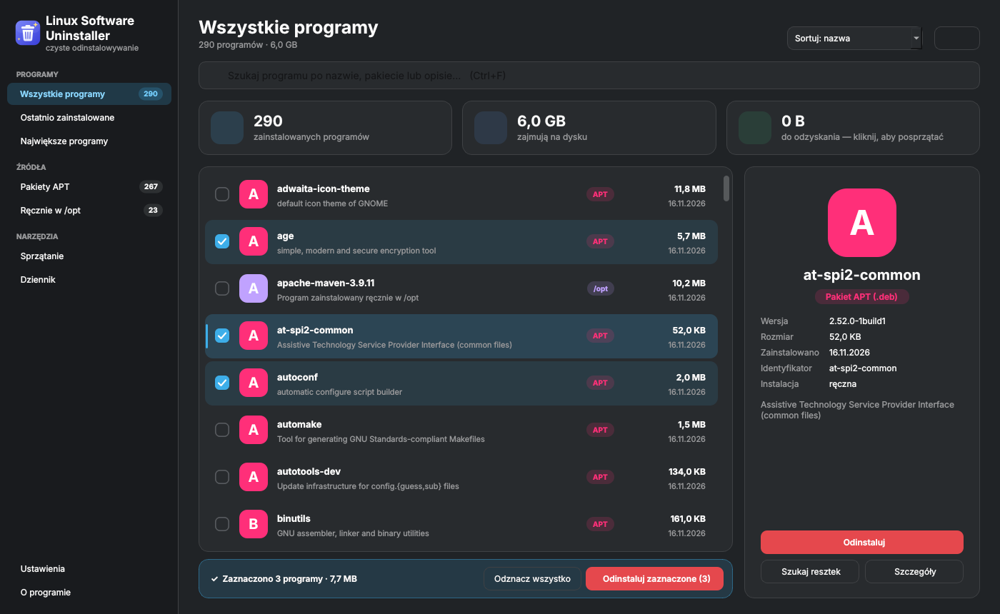
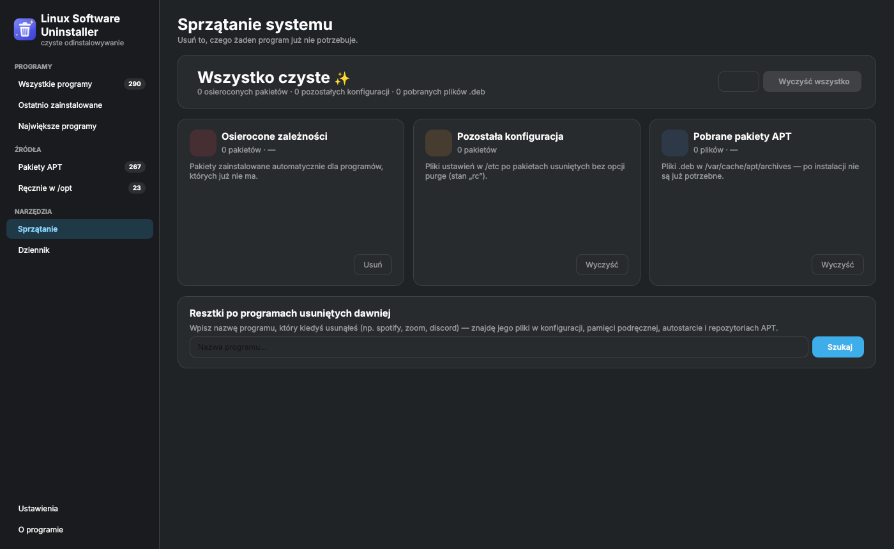
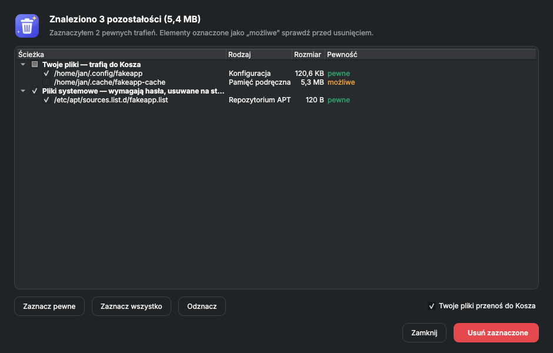
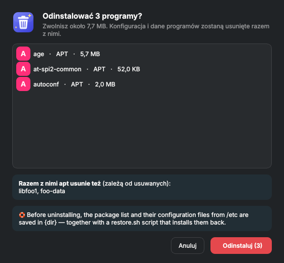

<div align="center">


# Linux Software Uninstaller

**Usuwaj programy z Linuksa do końca — razem z ich konfiguracją i pozostałościami.**

Odpowiednik IObit Uninstaller dla Debiana i KDE Plasma. APT, Flatpak, Snap, AppImage i `/opt` w jednym oknie.

[](LICENSE)


🇬🇧 [Read in English](README.md)

</div>



> **Języki:** angielski (domyślny) i polski — przełączysz w *Ustawienia → Język*. Opcja *Automatycznie* wybiera język systemu.

## Możliwości

- **Wszystkie programy w jednym miejscu** — pakiety APT (`.deb`), Flatpak, Snap, pliki AppImage i programy rozpakowane ręcznie do `/opt`, z ikonami, rozmiarem i datą instalacji.
- **Wygodne widoki** — wszystkie programy, ostatnio zainstalowane, największe albo każde źródło osobno. Biblioteki i pakiety systemu bazowego są domyślnie ukryte.
- **Czyste odinstalowanie** — razem z konfiguracją i danymi (`apt purge`, `flatpak --delete-data`, `snap --purge`).
- **Zabezpieczenia** — pokazuje, co jeszcze usunie APT, ostrzega przed pakietami ważnymi dla systemu (KDE, sddm, działające jądro, apt…) i nie pozwala usunąć pakietów niezbędnych (*Essential*).
- **Kopia zapasowa przed odinstalowaniem**, dobierana automatycznie:
  | Twój system | Co się dzieje |
  |---|---|
  | btrfs + snapper | snapshot snappera |
  | btrfs | snapshot tylko do odczytu w `/.snapshots` |
  | ext4 itp. + Timeshift | punkt przywracania Timeshift |
  | każdy inny przypadek | lista pakietów + ich pliki konfiguracyjne z `/etc` + skrypt `restore.sh` w `/var/backups/linux-software-uninstaller` |
- **Wyszukiwanie pozostałości** — po odinstalowaniu znajduje pliki zostawione w `~/.config`, `~/.local`, `~/.cache`, `~/.var/app`, autostarcie, menu, usługach systemd, `/etc`, `/var/lib`, repozytoriach APT i ich kluczach. Twoje pliki trafiają do **Kosza**, więc można je przywrócić.
- **Sprzątanie systemu** — osierocone zależności, konfiguracja po usuniętych pakietach (stan `rc`) i pobrane pliki `.deb` — jednym kliknięciem.
- **Dziennik** wszystkich operacji.
- **Wygląda natywnie** — dopasowuje się do jasnego i ciemnego motywu KDE.
- **Wielojęzyczny** — angielski i polski albo automatycznie język systemu.

<table>
  <tr>
    <td></td>
    <td></td>
  </tr>
  <tr>
    <td></td>
    <td></td>
  </tr>
</table>

## Instalacja

### Z wydania (zalecane)

Pobierz najnowszy plik `linux-software-uninstaller_*_all.deb` z zakładki [Releases](../../releases) i uruchom:

```bash
sudo apt install ./linux-software-uninstaller_*_all.deb
```

Program znajdziesz w menu: **System → Linux Software Uninstaller** albo uruchomisz poleceniem `linux-software-uninstaller`.

### Samodzielne zbudowanie pakietu

```bash
git clone https://github.com/USERNAME/linux-software-uninstaller.git
cd linux-software-uninstaller
./packaging/build-deb.sh
sudo apt install ./linux-software-uninstaller_*_all.deb
```

### Uruchomienie bez instalacji

```bash
sudo apt install python3-pyqt6
python3 -m linux_software_uninstaller
```

### Wymagania

- Debian 13 „trixie” lub nowszy (inne dystrybucje oparte na Debianie też powinny działać)
- Python 3.11+, PyQt6 (`python3-pyqt6`)
- polkit z działającym agentem uwierzytelniania (w KDE: `polkit-kde-agent-1`) i `pkexec`
- opcjonalnie: `qt6-svg-plugins` (ikony), `btrfs-progs` / `snapper` / `timeshift` (kopie zapasowe), `flatpak`, `snapd`

## Jak używać

1. Znajdź program — wpisz nazwę w wyszukiwarkę (<kbd>Ctrl</kbd>+<kbd>F</kbd>) albo wybierz widok po lewej.
2. Zaznacz jeden lub kilka programów (kliknij kwadracik, kliknij dwukrotnie wiersz albo naciśnij <kbd>Spacja</kbd>).
3. Kliknij **Odinstaluj zaznaczone** i sprawdź podsumowanie. Hasło podajesz raz.
4. Przejrzyj znalezione pozostałości — pewne trafienia są już zaznaczone, „możliwe” zaznaczasz sam.

| Skrót | Działanie |
|---|---|
| <kbd>Ctrl</kbd>+<kbd>F</kbd> | szukaj |
| <kbd>Spacja</kbd> | zaznacz / odznacz bieżący program |
| <kbd>Delete</kbd> | odinstaluj zaznaczone |
| <kbd>F5</kbd> | odśwież listę |
| <kbd>Esc</kbd> | wyczyść wyszukiwanie |

## Jak to działa i bezpieczeństwo

Okno programu zawsze działa jako zwykły użytkownik — **nie uruchamiaj go przez `sudo`**.

Wszystko, co wymaga uprawnień roota, robi mały pomocnik `/usr/libexec/linux-software-uninstaller/lsu-helper`, uruchamiany przez **polkit** (akcja `linux-software-uninstaller.helper`, hasło pamiętane przez kilka minut). Pomocnik przyjmuje tylko trzy polecenia — `uninstall`, `remove-paths` i `cleanup` — i sprawdza każdy argument:

- nazwy pakietów, snapów i Flatpaków muszą pasować do ścisłych wzorców,
- ścieżki muszą leżeć bezpośrednio w dozwolonym katalogu (np. `/etc`, `/var/lib`, `/opt`), nigdy w `/home` ani `/root`,
- pliki należące do zainstalowanych pakietów są odrzucane,
- kluczowe katalogi (`/etc/apt`, `/var/lib/dpkg`, `/etc/systemd`…) są zawsze chronione.

Wyszukiwanie pozostałości zgłasza tylko nazwy pasujące do usuniętego programu, pomija wszystko, co należy do nadal zainstalowanych programów, a niepewne trafienia oznacza jako „możliwe” — nigdy nie są usuwane bez Twojej decyzji.

## Pliki

| Ścieżka | Zawartość |
|---|---|
| `/usr/bin/linux-software-uninstaller` | program |
| `/usr/share/linux-software-uninstaller/` | moduły Pythona |
| `/usr/libexec/linux-software-uninstaller/lsu-helper` | pomocnik root |
| `~/.config/linux-software-uninstaller/` | ustawienia |
| `~/.local/state/linux-software-uninstaller/activity.log` | dziennik |
| `/var/backups/linux-software-uninstaller/` | kopie konfiguracji (tylko root) |

Więcej szczegółów dla Debiana — przywracanie kopii, reguły polkit, rozwiązywanie problemów — znajdziesz w [debian/README.Debian](debian/README.Debian) (po angielsku).

## Współtworzenie

Zgłoszenia błędów i pull requesty są mile widziane. Szczególnie przydadzą się:

- **tłumaczenia** na kolejne języki — teksty są w [`linux_software_uninstaller/i18n.py`](linux_software_uninstaller/i18n.py), instrukcja w [README.md](README.md#translating),
- obsługa innych menedżerów pakietów (dnf, pacman, zypper),
- testy na innych środowiskach graficznych i dystrybucjach.

Przed wysłaniem pull requesta sprawdź, czy kod się kompiluje:

```bash
python3 -m py_compile linux_software_uninstaller/*.py
```

## Odinstalowanie

```bash
sudo apt purge linux-software-uninstaller
rm -r ~/.config/linux-software-uninstaller ~/.local/state/linux-software-uninstaller   # opcjonalnie
```

## Licencja

[GPL-3.0-or-later](LICENSE). Projekt nie jest powiązany z firmą IObit.
